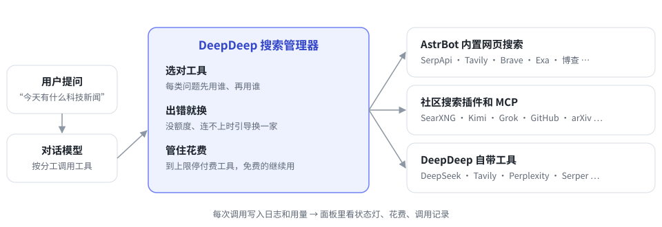
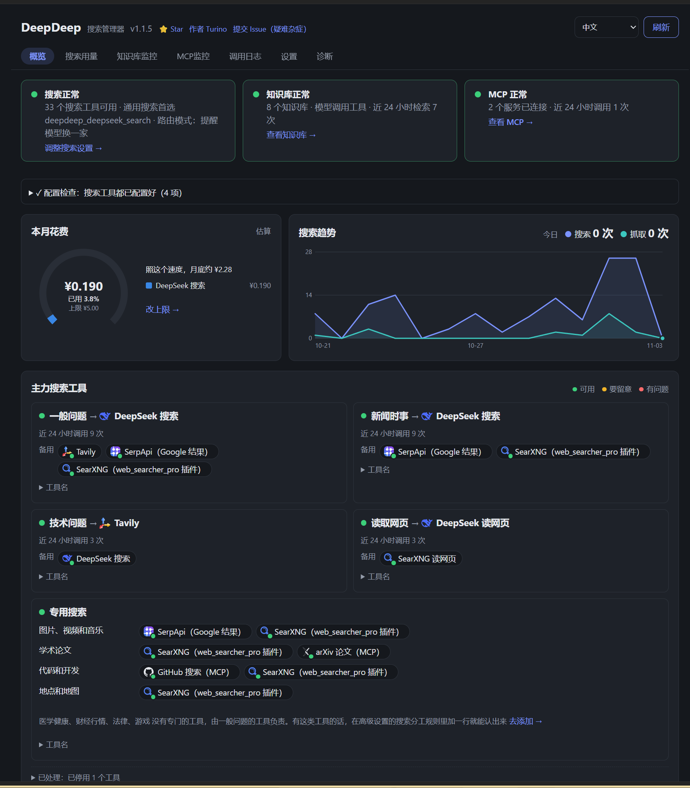
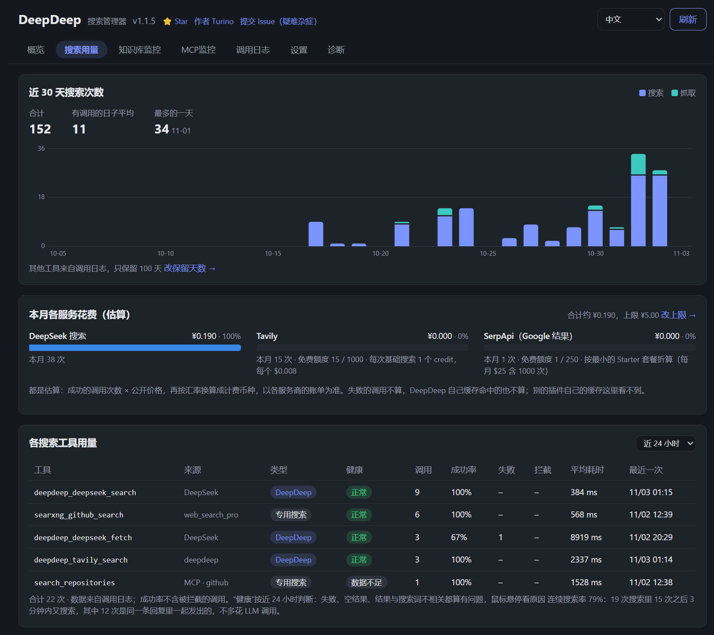
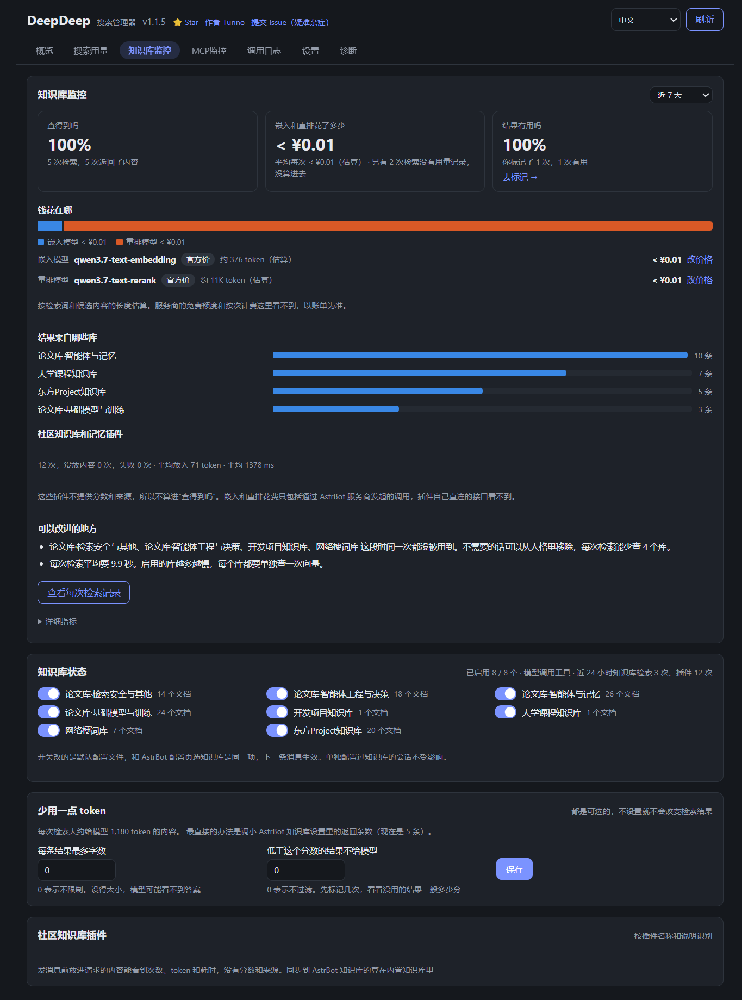
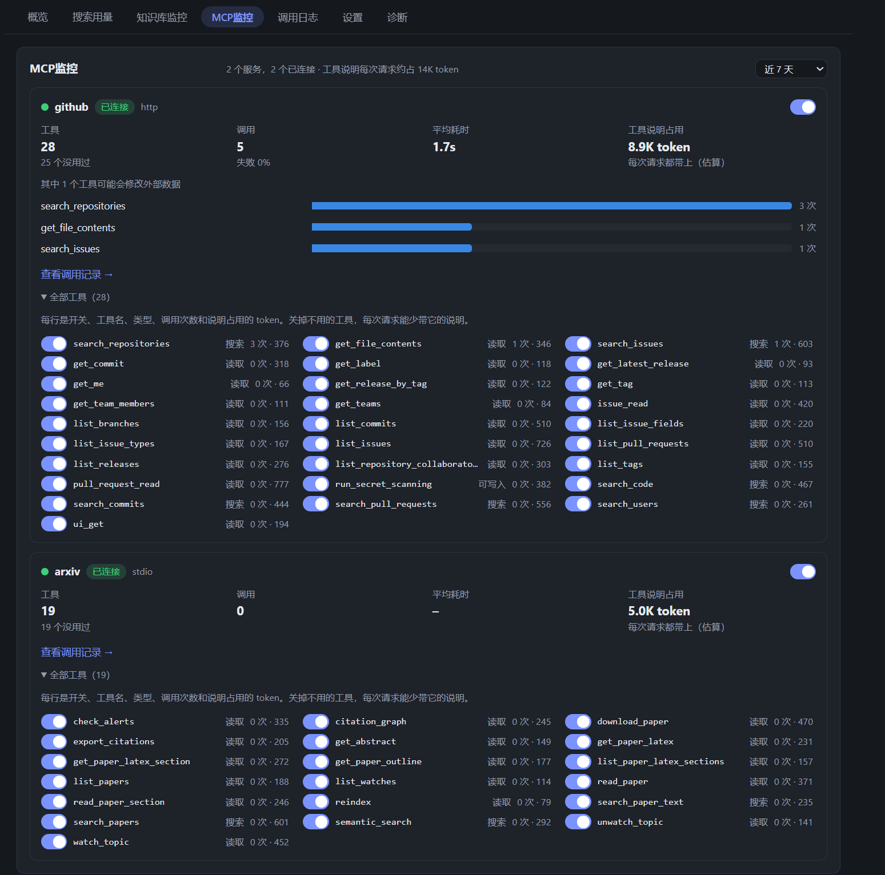
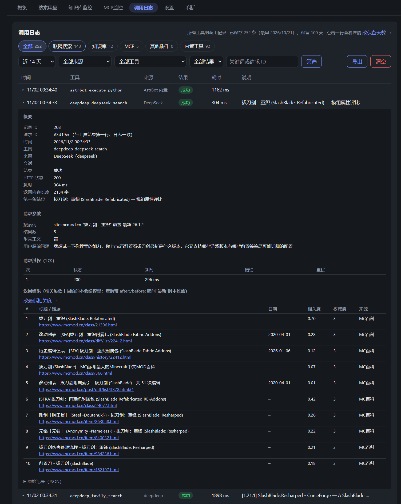
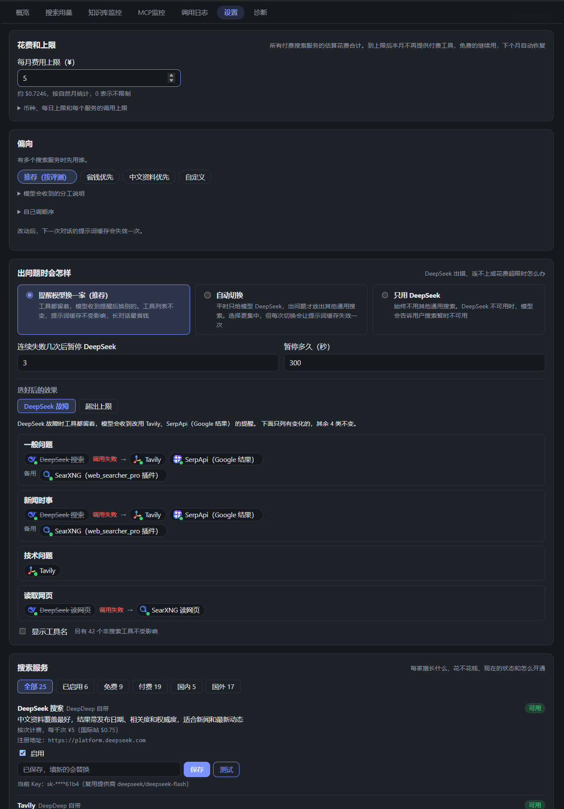

# DeepDeep 搜索管理器

**简体中文** | [English](docs/README_EN.md)

**统一管理和监控 AstrBot 的联网搜索（内置和社区插件）、知识库（内置和社区插件）和 MCP：自动选对搜索工具，出错就换一家，付费搜索到上限自动停，帮你改善搜索质量、看清花费。**

    

[为什么需要它](#为什么需要它) · [三步开始](#三步开始) · [支持的服务](#支持的服务) · [实测数据](#实测数据) · [面板](#面板) · [常见问题](#常见问题) · [详细说明](docs/GUIDE.md)

 

## 为什么需要它

搜索工具装得越多，模型越容易选错；哪家没额度了、哪家悄悄失效了，也很难及时发现。DeepDeep 不替换你已有的工具，只负责让它们配合好。

| | 只装搜索工具 | 加上 DeepDeep |
|---|---|---|
| **选哪个** | 模型自己猜，工具越多越容易乱 | 每类问题都有首选和备用，比如新闻找 DeepSeek，编程问题找 Tavily |
| **一家出问题** | 工具报错，模型不一定知道下一步 | 引导模型换一家，对话不中断 |
| **花了多少钱** | 去各家后台分别查 | 合并估算所有付费服务，到上限停付费工具，免费的继续用 |
| **工具失效** | 用户问起才发现 | 失败、没结果、结果不相关都会亮灯，并写明怎么处理 |
| **出了问题** | 翻 AstrBot 日志 | 每次调用都有记录，搜索工具还能看到第一条结果 |
| **知识库和 MCP** | 不知道查没查到、花了多少 | 看得到检索质量、嵌入和重排花费、MCP 连接状态和工具说明占用的 token，还能直接开关 |

## 三步开始

**1. 安装**：在 AstrBot 的插件市场搜索「DeepDeep」并安装。需要 AstrBot 4.26.0 或更高版本。

**2. 配一个搜索服务**：打开插件面板，没有可用搜索时，“概览”页会一步步带你选服务、填 Key、测试。不知道选哪个，可以看这里：

| 你的情况 | 推荐 | 费用 |
|---|---|---|
| 已经在 AstrBot 里用 DeepSeek 官方接口 | **DeepSeek**，自动复用 Key，不用再填 | 每千次约 ¥5 |
| 想先免费试试 | **Tavily** | 每月 1000 次免费 |
| 有自己的服务器 | **SearXNG**，需要自建并安装对应插件 | 免费 |

**3. 试一下**：问机器人一个需要联网的问题，比如“今天有什么科技新闻”。然后回到面板，“概览”页绿灯亮着、“调用日志”里有记录，就成功了。

价格和免费额度可能变化，以各服务官网为准。

## 支持的服务

装了什么就管什么，下面这些都能自动认出来，不用手动配置。不在列表里的工具，也可以在高级设置里加一条规则。

**AstrBot 内置网页搜索**

<table>
<tr>
<td align="center" width="88"> DeepSeek</td>
<td align="center" width="88"> Tavily</td>
<td align="center" width="88"> SerpApi</td>
<td align="center" width="88"> Brave</td>
<td align="center" width="88"> Exa</td>
<td align="center" width="88"> Firecrawl</td>
<td align="center" width="88"> AnySearch</td>
<td align="center" width="88"> 博查</td>
<td align="center" width="88"> 百度 AI</td>
</tr>
</table>

**社区搜索插件和 MCP**

<table>
<tr>
<td align="center" width="88"> SearXNG</td>
<td align="center" width="88"> Kimi</td>
<td align="center" width="88"> Grok</td>
<td align="center" width="88"> Gemini</td>
<td align="center" width="88"> MiniMax</td>
<td align="center" width="88"> Keenable</td>
<td align="center" width="88"> Linkup</td>
<td align="center" width="88"> You.com</td>
<td align="center" width="88"> Nimble</td>
</tr>
<tr>
<td align="center" width="88"> GitHub</td>
<td align="center" width="88"> arXiv</td>
</tr>
</table>

**DeepDeep 自带工具**（填 Key 就能用，不用另装插件）

<table>
<tr>
<td align="center" width="88"> DeepSeek</td>
<td align="center" width="88"> Tavily</td>
<td align="center" width="88"> Perplexity*</td>
<td align="center" width="88"> Serper*</td>
<td align="center" width="88"> Jina*</td>
<td align="center" width="88"> TinyFish*</td>
</tr>
</table>

* 实验性：可以填 Key 使用，但还没有在真实接口上验证过，面板上标着“未实测”。商标归各服务商所有。

**AstrBot 版本**：支持 4.26.0 及以上，每周自动用 AstrBot 官方镜像启动插件做一次兼容检查。

**聊天平台**：声明支持 OneBot（aiocqhttp）、webchat、Telegram。插件没有依赖具体平台的代码，其他平台通常也能用，只是没有逐一验证。

## 实测数据

分工不是凭感觉定的。下面是作者 2026 年 10 月的实测，样本不大，只作参考，方法和局限见[详细说明](docs/GUIDE.md#实测分工说明有没有用)。

| 测什么 | 结果 |
|---|---|
| **模型第一次选对工具**（真实的 79 个工具，39 个问题各问 3 次） | 不装插件 92 / 117 → 加上分工说明 **95 / 117**；不需要搜索的问题没有多搜 |
| **技术问题的结果质量**（满分 10） | DeepSeek 6.8，Tavily **8.8**，所以默认把技术问题交给 Tavily |
| **综合结果质量**（满分 10） | DeepSeek **7.6**，Tavily 6.3，所以一般问题默认先用 DeepSeek |
| **提示词开销** | 分工说明通常 150–250 token |
| **提示词缓存**（约 80 万 token 的长对话） | 连续对话命中率 99.8%–100% |

## 面板

| 页面 | 用来做什么 |
|---|---|
| 概览 | 搜索、知识库和 MCP 是否正常，需要处理的问题，本月花费和搜索趋势，每类问题用哪家 |
| 搜索用量 | 近 30 天搜索次数，各服务的花费和调用次数，调用上限用了多少 |
| 知识库监控 | 看检索查不查得到、嵌入和重排花了多少、结果有没有用，以及可以怎么改进 |
| MCP监控 | 各 MCP 服务的状态、用量，以及工具说明占用的 token |
| 调用日志 | 查看、筛选、导出每次工具调用，直接看到第一条结果 |
| 设置 | 每月花费上限、偏向（推荐 / 省钱 / 中文优先）、出问题时会怎样、填写 Key |
| 诊断 | 生成诊断信息、检测网络 |

普通使用只需要看“概览”和“设置”。设置改完会自动保存，难懂的选项都收在“高级设置”里，不用管也能正常工作。

搜索用量页截图

知识库监控页截图

MCP监控页截图

调用日志页截图

设置页截图

诊断页截图

## 常见问题

**需要用 DeepSeek 的聊天模型吗？**

不需要。搜索和聊天是分开的，用什么聊天模型都可以。也可以完全不用 DeepSeek 搜索，只用其他工具。

**要花多少钱？**

插件免费，费用来自你选的搜索服务。默认每月上限是 ¥30，可以改。面板显示的花费是按公开价格估算的，实际以各服务的账单为准。

**和 AstrBot 自带的网页搜索冲突吗？**

不冲突，可以一起用。AstrBot 的网页搜索一次只能选一家，DeepDeep 还能让你额外用上 Tavily 等服务；如果 AstrBot 选的就是 Tavily，DeepDeep 不会重复提供。

**面板显示黄灯或红灯怎么办？**

点开看提示，通常是某个工具没填 Key，或者最近搜索结果不好。按提示补上配置，或者停用这个工具、忽略这条提醒都可以。

**服务器连不上国外的搜索服务怎么办？**

在 AstrBot 的设置里配好网络代理，DeepDeep 的请求会自动跟随，不用单独设置。

**会影响模型的提示词缓存吗？**

平时不会。只有工具列表变化时（比如新填了一个 Key、达到花费上限）会失效一次，长对话时这一次会多花一些模型费用。

**会上传我的数据吗？**

调用日志只保存在你自己的服务器上。搜索时，搜索词和用户消息的前 128 字会发给 DeepSeek（发送消息这项可以关闭）；其他服务也会收到搜索词。

## 更多

- [详细说明](docs/GUIDE.md)：路由模式、分工规则、评测数据、完整配置项、隐私细节
- [更新日志](CHANGELOG.md)
- [反馈问题](https://github.com/liquidtoy001/astrbot_plugin_deepdeep/issues/new/choose)：请附上面板“诊断”页生成的诊断信息
- [参与开发](.github/CONTRIBUTING.md)

如果觉得好用，欢迎点个 ⭐ Star。

[MIT License](LICENSE)
