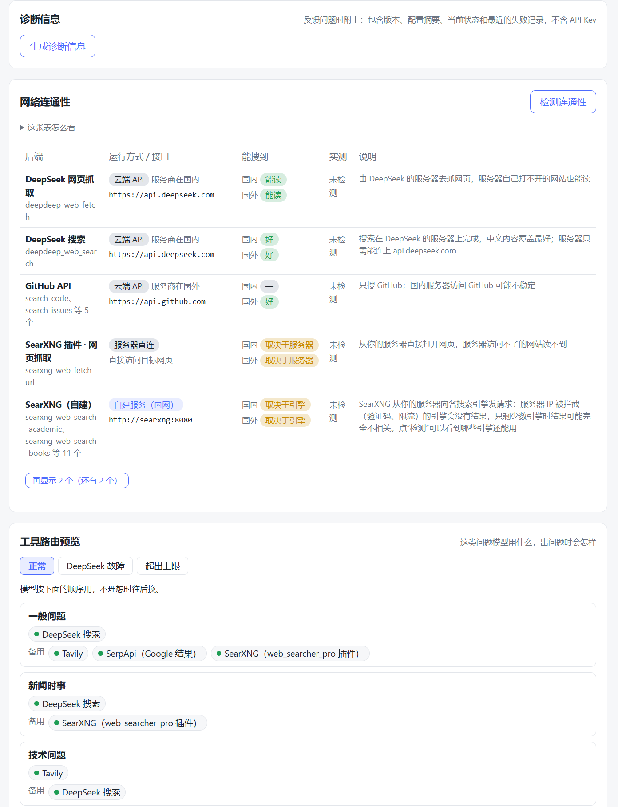

# DeepDeep

**简体中文** | [English](docs/README_EN.md)

**AstrBot 搜索管理器：帮机器人选对搜索工具，一家出问题就换另一家，还能管住花费。**

## 能帮你做什么

- **选对工具**：告诉模型每类问题先用哪个搜索工具，比如新闻找 DeepSeek，编程问题找 Tavily，找视频用视频搜索。
- **出错就换**：某家没额度或连不上时，引导模型改用其他工具，对话不用中断。
- **管住花费**：估算所有付费搜索的花费，到了每月上限就停用付费工具，免费的继续用。
- **一眼看状态**：面板用红黄绿灯显示搜索是否正常，缺了什么配置、去哪里填都写明。
- **查得到记录**：每次工具调用都有日志，出问题时知道发生了什么。

已经装了别的搜索工具也没关系，DeepDeep 不替换它们，只负责让它们配合好。

## 三步开始

**1. 安装**：在 AstrBot 的插件市场搜索「DeepDeep」并安装。需要 AstrBot 4.26.0 或更高版本。

**2. 配一个搜索服务**：打开插件面板，没有可用搜索时，“概览”页会一步步带你选服务、填 Key、测试。不知道选哪个，可以看这里：

| 你的情况 | 推荐 | 费用 |
|---|---|---|
| 已经在 AstrBot 里用 DeepSeek 官方接口 | **DeepSeek**，自动复用 Key，不用再填 | 每千次约 ¥5 |
| 想先免费试试 | **Tavily** | 每月 1000 次免费 |
| 有自己的服务器 | **SearXNG**，需要自建并安装对应插件 | 免费 |

**3. 试一下**：问机器人一个需要联网的问题，比如“今天有什么科技新闻”。然后回到面板，“概览”页绿灯亮着、“调用日志”里有记录，就成功了。

价格和免费额度可能变化，以各服务官网为准。

## 面板里有什么

| 页面 | 用来做什么 |
|---|---|
| 概览 | 搜索是否正常、本月花费、今日用量 |
| 用量 | 各服务的花费占比和调用次数 |
| 调用日志 | 查看、筛选、导出每次工具调用 |
| 设置 | 每月花费上限、偏向（推荐 / 省钱 / 中文优先）、填写 Key |
| 工具与诊断 | 生成诊断信息、检测网络、查看每类问题会用哪些工具 |

普通使用只需要看“概览”和“设置”。设置改完会自动保存，难懂的选项都收在“高级设置”里，不用管也能正常工作。

用量页截图

工具与诊断页截图

## 常见问题

**需要用 DeepSeek 的聊天模型吗？**

不需要。搜索和聊天是分开的，用什么聊天模型都可以。也可以完全不用 DeepSeek 搜索，只用其他工具。

**要花多少钱？**

插件免费，费用来自你选的搜索服务。默认每月上限是 ¥30，可以改。面板显示的花费是按公开价格估算的，实际以各服务的账单为准。

**和 AstrBot 自带的网页搜索冲突吗？**

不冲突，可以一起用。AstrBot 的网页搜索一次只能选一家，DeepDeep 还能让你额外用上 Tavily 等服务；如果 AstrBot 选的就是 Tavily，DeepDeep 不会重复提供。

**面板显示黄灯或红灯怎么办？**

点开看提示，通常是某个工具没填 Key，或者最近搜索结果不好。按提示补上配置，或者停用这个工具、忽略这条提醒都可以。

**会影响模型的提示词缓存吗？**

平时不会。只有工具列表变化时（比如新填了一个 Key、达到花费上限）会失效一次，长对话时这一次会多花一些模型费用。

**会上传我的数据吗？**

调用日志只保存在你自己的服务器上。搜索时，搜索词和用户消息的前 128 字会发给 DeepSeek（发送消息这项可以关闭）；其他服务也会收到搜索词。

## 支持情况

- **聊天平台**：声明支持 OneBot（aiocqhttp）、webchat、Telegram。插件没有依赖具体平台的代码，其他平台通常也能用，只是没有逐一验证。
- **实验性服务**：Perplexity、Serper、Jina、TinyFish 可以填 Key 使用，但还没有在真实接口上验证过，面板上标着“未实测”。

## 更多

- [详细说明](docs/GUIDE.md)：路由模式、分工规则、评测数据、完整配置项、隐私细节
- [更新日志](CHANGELOG.md)
- [反馈问题](https://github.com/liquidtoy001/astrbot_plugin_deepdeep/issues/new/choose)：请附上面板“工具与诊断”页生成的诊断信息
- [参与开发](.github/CONTRIBUTING.md)

如果觉得好用，欢迎点个 ⭐ Star。

[MIT License](LICENSE)
