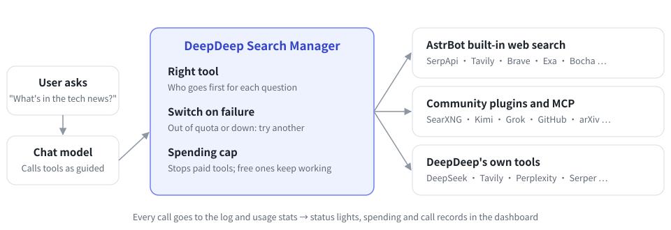
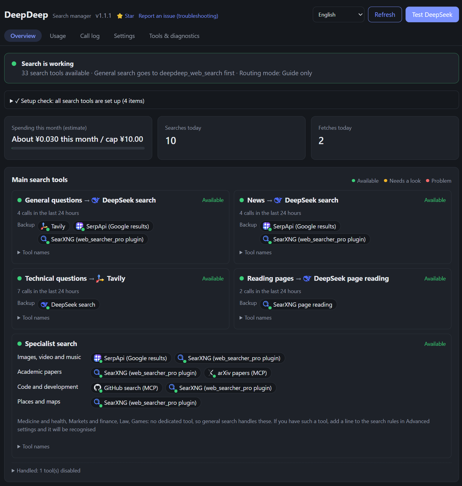
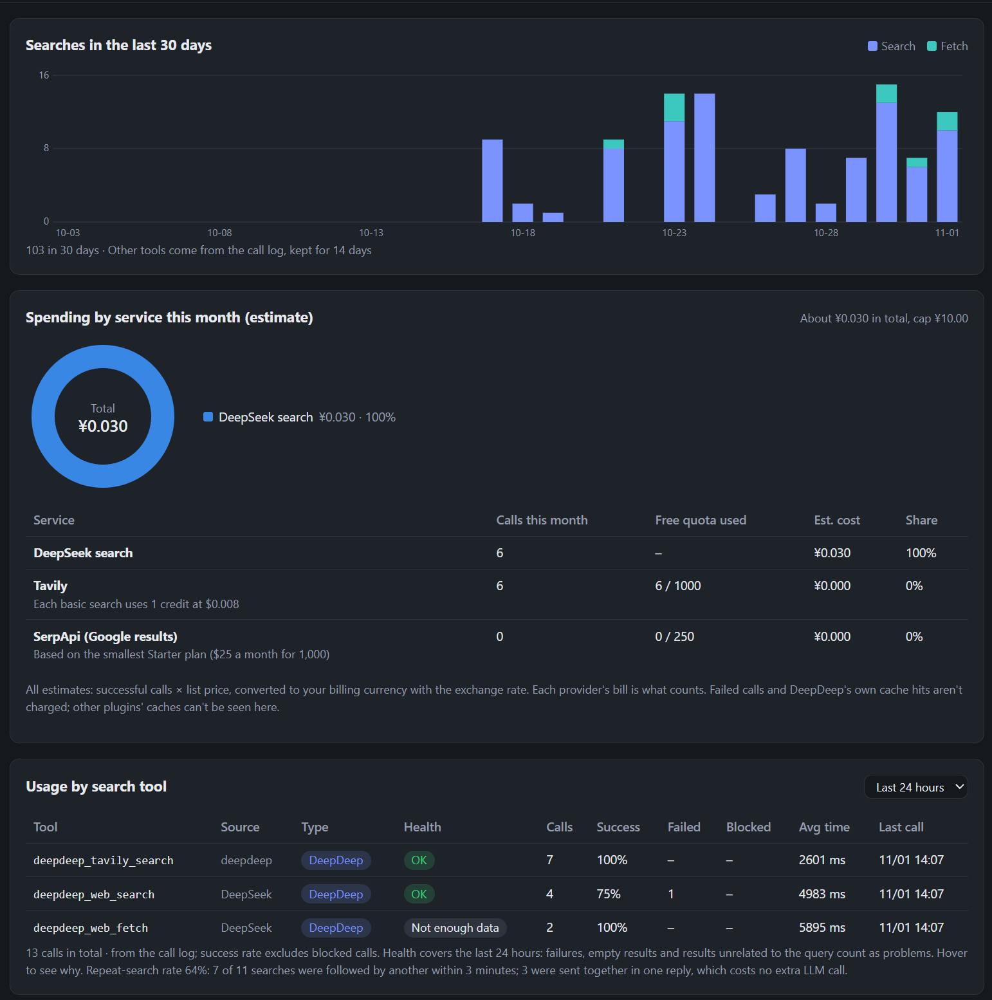
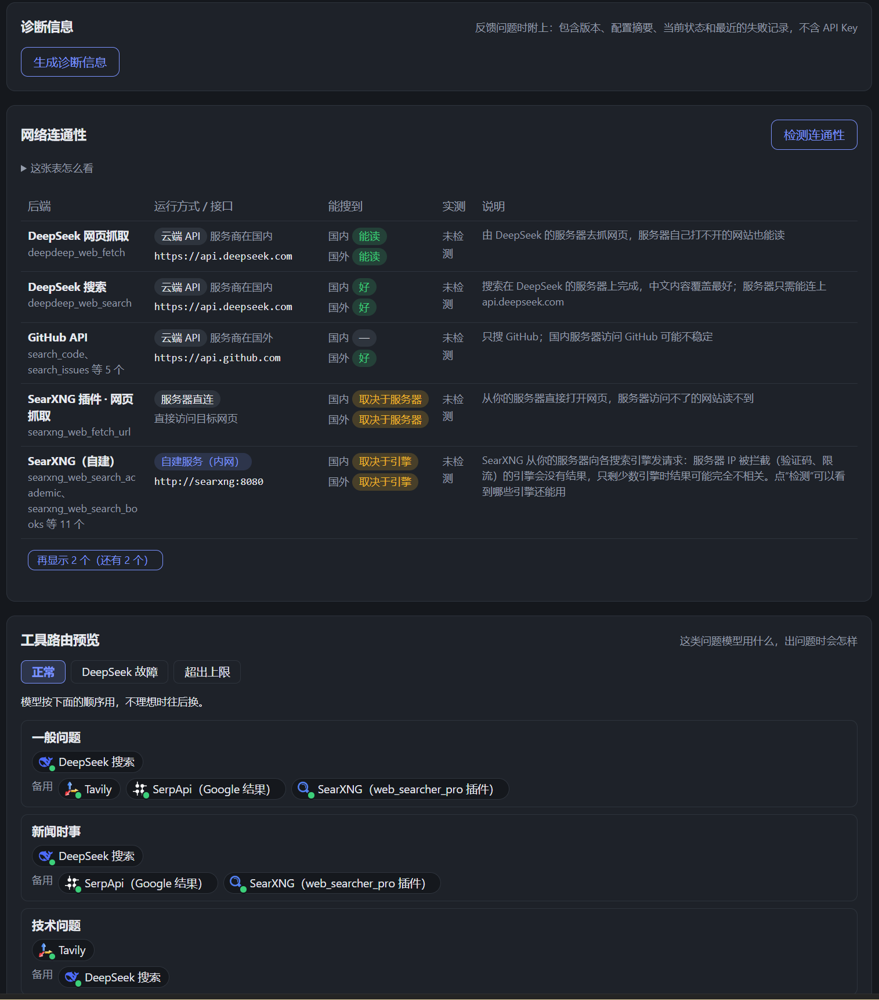

# DeepDeep Search Manager

[简体中文](../README.md) | **English**

**Manage AstrBot's built-in web search and community search plugins in one place: pick the right tool, switch when one fails, and stop paid search at your spending cap.**

    

[Why](#why-you-need-it) · [Get started](#get-started-in-three-steps) · [Supported services](#supported-services) · [Test results](#test-results) · [Dashboard](#dashboard) · [FAQ](#faq) · [Full guide](GUIDE_EN.md)

 

## Why you need it

The more search tools you install, the easier it is for the model to pick the wrong one, and it's hard to notice when a service runs out of quota or quietly stops working. DeepDeep doesn't replace your tools; it helps them work together.

| | Search tools alone | With DeepDeep |
|---|---|---|
| **Which tool** | The model guesses, and more tools make it worse | Each kind of question has a first choice and a backup, such as DeepSeek for news and Tavily for programming |
| **When one fails** | The tool returns an error and the model may not know what to do next | The model is steered to another service and the conversation continues |
| **Spending** | Check each provider's site separately | Estimates all paid services together and stops paid tools at your cap; free ones keep working |
| **Broken tools** | You find out when someone complains | Failures, empty results and irrelevant results light up, with a hint on what to do |
| **Troubleshooting** | Dig through AstrBot's logs | Every call is logged, and search calls show their top result |

## Get started in three steps

**1. Install**: search for "DeepDeep" in AstrBot's plugin market and install it. It needs AstrBot 4.26.0 or later.

**2. Set up a search service**: open the plugin dashboard. If no search is available, the Overview page walks you through choosing a service, entering a key and testing it. If you're not sure which to choose:

| Your situation | Recommended | Cost |
|---|---|---|
| You already use the official DeepSeek API in AstrBot | **DeepSeek**, which reuses that key automatically | About ¥5 per 1,000 searches |
| You want to try it for free | **Tavily** | 1,000 free searches a month |
| You have your own server | **SearXNG**, self-hosted, with its plugin installed | Free |

**3. Try it**: ask your bot something that needs the web, such as "what's in the tech news today?". Then go back to the dashboard. If the Overview light is green and the Call log has an entry, it worked.

Prices and free quotas can change, so check each service's website.

## Supported services

DeepDeep manages whatever you have installed. Everything below is recognized automatically. For other tools, add a rule under Advanced settings.

**AstrBot built-in web search**

<table>
<tr>
<td align="center" width="88"> DeepSeek</td>
<td align="center" width="88"> Tavily</td>
<td align="center" width="88"> SerpApi</td>
<td align="center" width="88"> Brave</td>
<td align="center" width="88"> Exa</td>
<td align="center" width="88"> Firecrawl</td>
<td align="center" width="88"> AnySearch</td>
<td align="center" width="88"> Bocha</td>
<td align="center" width="88"> Baidu AI</td>
</tr>
</table>

**Community search plugins and MCP**

<table>
<tr>
<td align="center" width="88"> SearXNG</td>
<td align="center" width="88"> Kimi</td>
<td align="center" width="88"> Grok</td>
<td align="center" width="88"> Gemini</td>
<td align="center" width="88"> MiniMax</td>
<td align="center" width="88"> Keenable</td>
<td align="center" width="88"> Linkup</td>
<td align="center" width="88"> You.com</td>
<td align="center" width="88"> Nimble</td>
</tr>
<tr>
<td align="center" width="88"> GitHub</td>
<td align="center" width="88"> arXiv</td>
</tr>
</table>

**DeepDeep's own tools** (add a key and they work, no extra plugin needed)

<table>
<tr>
<td align="center" width="88"> DeepSeek</td>
<td align="center" width="88"> Tavily</td>
<td align="center" width="88"> Perplexity*</td>
<td align="center" width="88"> Serper*</td>
<td align="center" width="88"> Jina*</td>
<td align="center" width="88"> TinyFish*</td>
</tr>
</table>

* Experimental: they work once you add a key, but haven't been verified against their real APIs. The dashboard marks them 未实测 (untested). Trademarks belong to their owners.

**AstrBot versions**: 4.26.0 and later. A weekly check starts the plugin in the official AstrBot image.

**Chat platforms**: OneBot (aiocqhttp), webchat and Telegram are declared. The plugin has no platform-specific code, so others usually work too, but they haven't been checked one by one.

## Test results

The defaults come from tests, not guesses. These are the author's tests from October 2026. The samples are small, so treat them as a guide. See the [full guide](GUIDE_EN.md) for methods and limits.

| What was tested | Result |
|---|---|
| **Model picks the right tool first** (79 real tools, 39 questions asked 3 times each) | Without the plugin 92 / 117 → with the guidance **95 / 117**; questions that need no search didn't trigger any |
| **Result quality on technical questions** (out of 10) | DeepSeek 6.8, Tavily **8.8**, so technical questions go to Tavily by default |
| **Overall result quality** (out of 10) | DeepSeek **7.6**, Tavily 6.3, so general questions try DeepSeek first by default |
| **Prompt overhead** | The guidance is usually 150–250 tokens |
| **Prompt cache** (long conversation of about 800k tokens) | 99.8%–100% hit rate in continuous chat |

## Dashboard

| Page | What it's for |
|---|---|
| Overview | Whether search works, this month's spending, today's usage, which service handles each kind of question |
| Usage | Spending share and calls per service |
| Call log | View, filter and export every tool call, with the top result shown |
| Settings | Monthly spending cap, preference (recommended, save money, Chinese first), API keys |
| Tools & diagnostics | Generate diagnostics, check the network, see which tools each kind of question uses |

For everyday use you only need Overview and Settings. Settings save automatically, and the harder options are under Advanced, where you can leave them alone.

Usage page screenshot

Tools &amp; diagnostics page screenshot (Chinese interface)

## FAQ

**Do I need a DeepSeek chat model?**

No. Search and chat are separate, so any chat model works. You can also skip DeepSeek search and use only other tools.

**How much does it cost?**

The plugin is free. Costs come from the search services you choose. The default monthly cap is ¥30, and you can change it. The dashboard's spending is an estimate from public prices; each service's bill is what counts.

**Does it conflict with AstrBot's built-in web search?**

No, they work together. AstrBot's web search uses one provider at a time, and DeepDeep lets you add services such as Tavily on top. If AstrBot already uses Tavily, DeepDeep doesn't offer it twice.

**What should I do about a yellow or red light?**

Open it and read the hint. Usually a tool has no key, or its recent results were poor. Add the missing setting, stop the tool or ignore the warning.

**What if my server can't reach overseas search services?**

Set up the network proxy in AstrBot's settings. DeepDeep's requests follow it automatically, with nothing else to configure.

**Does it affect prompt caching?**

Not normally. The cache is invalidated once when the tool list changes, for example when you add a key or reach the spending cap. In long conversations, that one time costs a bit more in model fees.

**Does it upload my data?**

Call logs stay on your own server. When searching, the search terms and the first 128 characters of the user's message go to DeepSeek (you can turn off sending the message). Other services also receive the search terms.

## More

- [Full guide](GUIDE_EN.md): routing modes, division-of-labor rules, evaluation data, privacy details
- [Changelog (Chinese)](../CHANGELOG.md)
- [Report a problem](https://github.com/liquidtoy001/astrbot_plugin_deepdeep/issues/new/choose): please attach the diagnostics from the Tools & diagnostics page
- [Contributing](../.github/CONTRIBUTING.md)

If you find it useful, a ⭐ Star is welcome.

[MIT License](../LICENSE)
